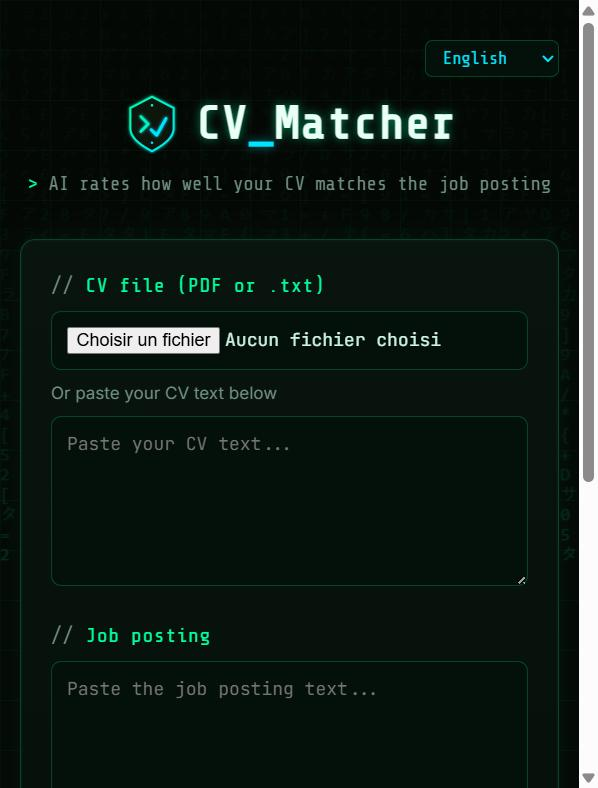

# CV Matcher — AI CV ↔ job posting matcher

AI-powered tool that compares your **CV** against a **job posting** and tells you
whether it's worth applying — and how to improve your chances. Built with
Python + FastAPI and the **Anthropic Claude** API.

Paste (or upload) your CV and a job posting, and the tool returns a match score,
an estimated salary range, your strengths and gaps, ATS-readiness, company
insights, and — on demand — a tailored CV and a cover letter.



## Features

- **Match analysis** — match score (0–100 %), a verdict on whether to apply, the
  detected company name, your strengths, missing keywords/skills, and concrete
  improvement suggestions.
- **Salary estimate** — an indicative salary range for a similar position in the
  region.
- **ATS preview** — simulates how an Applicant Tracking System *reads* your CV:
  an ATS-compatibility score, the fields it would parse (name, contact, title,
  skills), formatting warnings, keyword coverage vs the posting, and fixes.
  It also shows the **plain text extracted from your PDF** — exactly what an ATS
  sees.
- **Tailored CV** — rewrites your CV to better fit the posting (no invented
  experience).
- **Cover letter** — writes a cover letter addressed to the company, based on
  your CV and the posting.
- **Company insights** — a web-search summary of what the company does, its
  size, hiring activity, growth, and public reviews of its culture.
- **Multilingual UI** — interface in **10 languages**: English, Français,
  Lietuvių, Português, Español, Deutsch, Italiano, Polski, Русский, العربية
  (Arabic is right-to-left). AI answers are generated in the language of your
  CV / the posting.

## Tech stack

- **Python 3.11+ / FastAPI**
- **Anthropic Claude** API (`anthropic` SDK) — structured analysis via tool use,
  company insights via the server-side web-search tool
- **Jinja2** templates, plain HTML/CSS/JS (no Node.js build step)
- **pypdf** for PDF text extraction
- Matrix / cyber themed UI (monospace fonts, neon accents, animated background)

## Getting started

1. Clone the repository and create a virtual environment:

   ```bash
   python -m venv .venv
   # Windows:
   .venv\Scripts\activate
   # macOS / Linux:
   source .venv/bin/activate
   ```

2. Install dependencies:

   ```bash
   pip install -r requirements.txt
   ```

3. Set your API key:

   ```bash
   cp .env.example .env
   ```

   Put your `ANTHROPIC_API_KEY` in `.env` (create one at
   [console.anthropic.com](https://console.anthropic.com/); the account needs
   credits). The `.env` file is git-ignored and never committed.

4. Run the server:

   ```bash
   uvicorn app.main:app --reload
   ```

5. Open <http://127.0.0.1:8000> in your browser.

## Project structure

```
cv-matcher/
├── app/
│   ├── main.py        # FastAPI routes (form, analysis, generation endpoints)
│   ├── matcher.py     # Claude API calls: analysis, CV rewrite, cover letter,
│   │                  #   company insights, ATS view
│   ├── i18n.py        # UI translations for 10 languages
│   └── pdf_utils.py   # Text extraction from PDF / text files
├── templates/
│   └── index.html     # Form, results, and client-side rendering
├── static/
│   ├── style.css      # Matrix / cyber theme
│   └── logo.svg       # Logo (also used as favicon)
├── requirements.txt
├── .env.example
└── README.md
```

The code is documented throughout with inline comments and docstrings
(in Lithuanian) explaining each module, route, and API call.

## Configuration

| Variable            | Description                                                        |
| ------------------- | ------------------------------------------------------------------ |
| `ANTHROPIC_API_KEY` | Your Anthropic API key (required).                                 |
| `ANTHROPIC_MODEL`   | Model to use. Default: `claude-sonnet-5-5` (fast, inexpensive). Use `claude-opus-4-8` for higher-quality analysis. |

## Notes & limitations

- Salary ranges and company insights are **indicative** and based on public
  information — they may be incomplete or out of date, especially for small
  companies.
- The ATS preview is an **approximation**: real ATS platforms (Workday, Taleo,
  Lever, …) differ. The extracted plain text, however, is a faithful picture of
  what a basic ATS ingests.
- Each analysis makes a paid Claude API call; company insights also use web
  search, which costs a little more.

## Author

**Saulius Stankevičius** · [VILNIUS TECH](https://vilniustech.lt)
[GitHub](https://github.com/sallislt) ·
[LinkedIn](https://www.linkedin.com/in/saulius-stankevicius/)

## License

[MIT](LICENSE)
